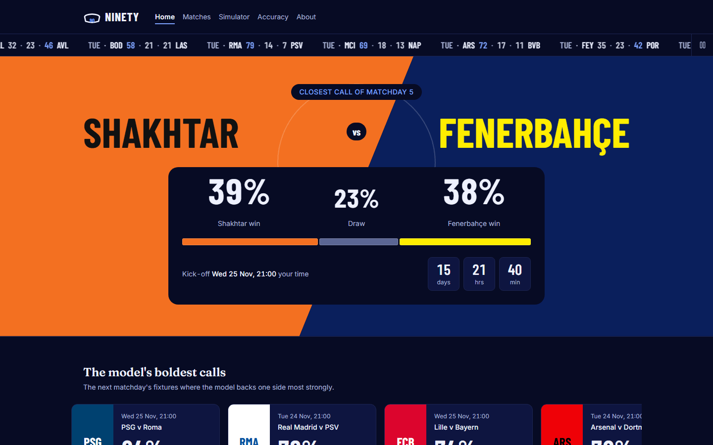
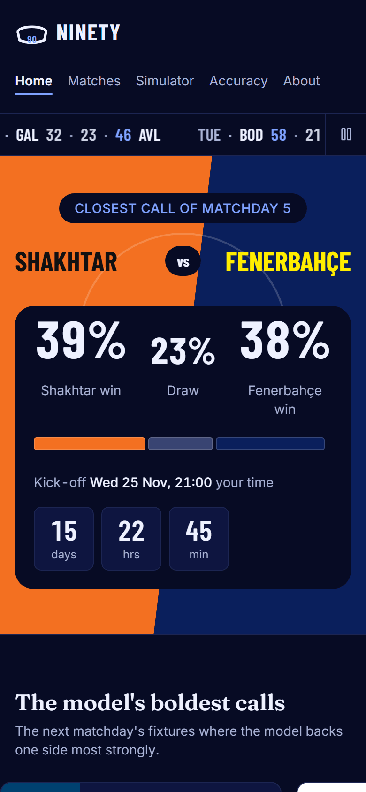
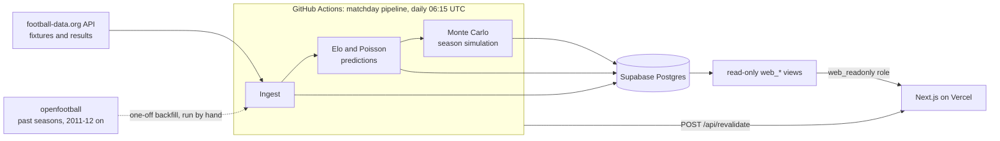

# Ninety — Champions League predictor

Pre-kick-off win/draw/loss probabilities for every Champions League match, a Monte Carlo simulation
of the whole season, and a public scorecard that grades every prediction once the match is played.

**Live site: [ucl-predictor-red.vercel.app](https://ucl-predictor-red.vercel.app)**

<p>
  
  &nbsp;
  
</p>

More screenshots: [matches](docs/screenshots/matches-1440.png) ·
[simulator](docs/screenshots/simulator-1440.png) · [accuracy](docs/screenshots/accuracy-1440.png)
(phone versions are the `-390.png` files).

## What it does

- **Predicts every match** with an Elo rating model built from every Champions League match since
  2011-12, plus an Elo-driven Poisson goals model tracked alongside it.
- **Simulates the season**: thousands of runs of the remaining league phase and the knockout
  bracket give each club's chance of the top 8, the play-offs, each round and the title.
- **Grades itself in public**: every finished match is scored (log loss, RPS) against the
  prediction that was locked before kick-off, next to a "guess a third each" baseline.
- **Runs on its own**: a daily GitHub Actions pipeline ingests results, re-predicts, re-simulates
  and refreshes the site.

## Results

Walk-forward backtest on the five test seasons, **2021-22 to 2025-26 (753 main-competition
matches)**. Each match is predicted only from matches played before it. Lower is better for both
metrics.

| Model                | Log loss |   RPS |
| -------------------- | -------: | ----: |
| **Elo** (primary)    |    0.945 | 0.203 |
| Blend                |    0.946 | 0.203 |
| Poisson (shrunk)     |    0.946 | 0.203 |
| Poisson (calibrated) |    0.949 | 0.203 |
| Poisson              |    0.949 | 0.204 |
| Base rates           |    1.030 | 0.235 |
| Guessing (⅓ each)    |    1.099 | 0.247 |

As of 9 November 2026, from the live [accuracy page](https://ucl-predictor-red.vercel.app/accuracy).
Poisson (shrunk) scales down how much the rating gap moves expected goals, which pulls predictions
toward an even match. Poisson (calibrated) applies temperature scaling to the three probabilities.
Blend averages Elo and Poisson (calibrated). Both adjustments are fitted on validation seasons only.

All the models land within 0.004 of each other. Every one of them beats base rates by about 0.08 and
guessing by about 0.15 in log loss.

**This season, live:** the [accuracy page](https://ucl-predictor-red.vercel.app/accuracy) scores
every 2026-27 prediction as results come in, with each prediction listed next to its outcome.

## Architecture



- **`apps/engine`** (Python) owns the schema (Alembic) and does every write: ingest, models,
  backtests, the simulator and the pipeline.
- **`apps/web`** (Next.js) reads only five `web_*` views, through a login role that can read nothing
  else. Pages are cached, and the pipeline expires the cache through an authenticated revalidate
  webhook after each run.

## How it stays honest

- **Predictions are locked before kick-off by the database clock.** `created_at` is always set by
  Postgres (`now()`), never by Python, and only predictions created before kick-off count.
- **Predictions are append-only.** The engine only inserts them; no code path updates or deletes a
  prediction. This is a rule in the code, not a database trigger.
- **The official prediction** for a match is the latest one made before kick-off. That is the one
  shown and the one scored.
- **Walk-forward backtest.** Each test match is predicted only from earlier matches. The Elo
  parameters and the Poisson adjustments are tuned on the validation seasons (2015-16 to 2020-21),
  never on the test seasons.
- **Pre-registered model choice.** The primary model is the one with the lowest validation log loss
  (tie-break: RPS). One safety gate applies: if that model is worse than Elo on test log loss, Elo
  stays primary. The rule is fixed in code (`choose_primary` in `engine.evaluate.candidates`), not
  picked by eye.
- **The site can't change anything.** The web app connects as a role with `SELECT` on the five
  views only.
- **Separate databases.** Development runs against its own database. Production, which holds
  pre-kick-off predictions that can't be recreated, is reachable only from GitHub Actions.

## Tech stack

| Area   | Tools                                                                                        |
| ------ | -------------------------------------------------------------------------------------------- |
| Engine | Python 3.12, uv, NumPy, SciPy, pandas, scikit-learn, SQLAlchemy, Alembic, pytest, ruff       |
| Web    | Next.js (App Router, Cache Components), React, TypeScript, Tailwind CSS, Drizzle ORM, Vitest |
| Data   | PostgreSQL: Supabase (production), Neon (development)                                        |
| Ops    | GitHub Actions (CI and the daily pipeline), Vercel                                           |

## Repo structure

```text
apps/
  engine/            Python engine: ingest, models, evaluate, simulate, pipeline
    migrations/      Alembic migrations (the only place the schema changes)
    src/engine/      package code
    tests/           unit tests, plus integration tests behind RUN_INTEGRATION=1
  web/               Next.js site (read-only)
    app/             pages, social card, revalidate API
    lib/             data access, team display names, model labels
docs/
  sql/               web_readonly role setup
  screenshots/       README images
.github/workflows/   ci.yml, matchday-pipeline.yml
```

More detail: [engine README](apps/engine/README.md) · [web README](apps/web/README.md)

## Run locally

Prerequisites: Node 24+, pnpm, [uv](https://docs.astral.sh/uv/), git, a PostgreSQL database you can
write to (a free Neon project works), and a free
[football-data.org](https://www.football-data.org/client/register) API token.

**Windows (PowerShell)**

```powershell
git clone https://github.com/aparedesp2003/ucl-predictor.git
cd ucl-predictor
Copy-Item .env.example .env      # fill in DATABASE_URL and FOOTBALL_DATA_TOKEN
pnpm install

cd apps\engine
uv sync
uv run alembic upgrade head
uv run python -m engine.ingest football-data
uv run python -m engine.ingest openfootball --from 2011-12 --to 2025-26
uv run python -m engine.models elo backtest --grid
uv run python -m engine.models poisson backtest
uv run python -m engine.pipeline run --force   # predict + simulate
cd ..\..

pnpm dev:web                     # http://localhost:3000
```

**macOS / Linux**

```sh
git clone https://github.com/aparedesp2003/ucl-predictor.git && cd ucl-predictor
cp .env.example .env             # fill in DATABASE_URL and FOOTBALL_DATA_TOKEN
pnpm install
(cd apps/engine && uv sync && uv run alembic upgrade head \
  && uv run python -m engine.ingest football-data \
  && uv run python -m engine.ingest openfootball --from 2011-12 --to 2025-26 \
  && uv run python -m engine.models elo backtest --grid \
  && uv run python -m engine.models poisson backtest \
  && uv run python -m engine.pipeline run --force)
pnpm dev:web
```

In development the web app falls back to `DATABASE_URL`. For the read-only role, see
[docs/sql/web_readonly.sql](docs/sql/web_readonly.sql) and the [web README](apps/web/README.md).

## Tests

```powershell
cd apps\engine
uv run ruff check . ; uv run ruff format --check . ; uv run pytest
$env:RUN_INTEGRATION=1; uv run pytest -m integration   # needs DATABASE_URL; rolled back
cd ..\..
pnpm --filter web lint ; pnpm --filter web typecheck ; pnpm --filter web test ; pnpm --filter web build
```

CI runs all of these except the integration tests, without a database.

## Data sources and attribution

- [football-data.org](https://www.football-data.org/): current-season fixtures, results and teams
  ("Football data provided by the Football-Data.org API").
- [openfootball](https://github.com/openfootball): Champions League results from 2011-12, used
  for the historical ratings and the backtest.

Team names and three-letter codes on the site are the project's own short forms. Club colours are
approximations picked by hand, not official brand colours.

## Limitations

- **Results only.** The models see past scores, nothing else: no injuries, line-ups, transfers,
  rest days or betting markets.
- **90 minutes only.** Every prediction is for the 90-minute result. Extra time and penalties are
  modelled only inside the simulator's knockout rounds.
- **Small samples.** One league phase is 144 matches, so this season's live scores are noisy for a
  long time. The backtest is the better guide to model quality.
- **Simulator approximations.** Ratings move only by a random per-season offset during a simulated
  season. The knockout bracket follows the published 2026-27 rules as closely as the project could
  implement them (see the roadmap).
- **Daily refresh.** The pipeline runs once a day, so a late fixture change shows up the next
  morning.

## Roadmap

Open issues:

- [#3 Verify 2026/27 knockout bracket against official draw procedure](https://github.com/aparedesp2003/ucl-predictor/issues/3)
- [#4 Title odds look concentrated: test knockout-stage calibration](https://github.com/aparedesp2003/ucl-predictor/issues/4)
- [#10 Match football-data teams on short name, not only full name](https://github.com/aparedesp2003/ucl-predictor/issues/10)
- [#11 Alias-aware duplicate detection in the ingest report](https://github.com/aparedesp2003/ucl-predictor/issues/11)

## Disclaimer

Independent fan project. Not affiliated with, endorsed by or connected to UEFA, the UEFA Champions
League or any club. Club names are used only to identify the teams.
